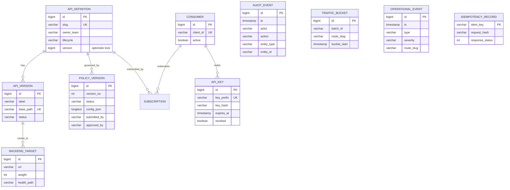

# Architecture

## 1. Problem, goals and assumptions

An enterprise runs many backend services used by internal teams and partners. It needs one place to **register APIs**,
**attach versioned security/traffic policies**, **manage consumers and keys**, **enforce** those policies on live traffic,
and **observe/investigate** the result - with audit and safe change management.

**Assumptions** (explicit so reviewers can challenge them):

1. Synthetic data; a single region; HTTP/1.1 between components (TLS terminated at the ingress locally, mTLS in production).
2. Policy changes are rare relative to requests (seconds-to-minutes propagation is acceptable; requests are hot-path).
3. The gateway must keep serving when the control plane is down (availability of the data plane > freshness of config).
4. Telemetry is for investigation and trends; Prometheus is the system of record for latency percentiles.
5. Management users are authenticated by an OIDC provider; consumers use API keys (or JWT) at the gateway.

## 2. Components and responsibilities

```
 Consumers ──HTTPS──▶ Ingress ──▶ Gateway (N replicas, stateless, data plane)
                                   │  ▲ snapshot (poll, ETag)      │ proxy
                                   │  │                            ▼
 Operators ──▶ Angular UI ──▶ Control plane (M replicas) ◀─── telemetry batches    Backend services (approved hosts only)
                                   │                                  
                              MySQL (system of record)        Redis (rate-limit counters, ephemeral)
                                   
 Observability: gateways/control plane ──/actuator/prometheus──▶ Prometheus ─▶ Grafana ; OTLP ─▶ Jaeger
```

| Concern | Control plane (`control-plane/`) | Gateway (`gateway/`) |
|---|---|---|
| State | MySQL: APIs, versions, targets, policy versions, consumers, keys, audit, telemetry buckets | Memory only: last-known-good snapshot (+ optional on-disk copy), breaker/health state, local limiter state |
| Responsibility | Validate, approve, version, audit and **publish** configuration; consumer/key lifecycle; read-models for operators | Resolve route, authenticate, authorize, limit, validate size/method/IP, proxy with timeout/retry/breaker, emit telemetry |
| Scaling | By operator load (low); stateless behind a load balancer; DB is the bottleneck | By consumer traffic (high); horizontally, CPU-bound; HPA on CPU |
| Failure impact | Config changes and the console stop; **traffic keeps flowing** | Traffic for its share stops; other replicas continue |
| Security boundary | JWT (OIDC) for users; service token (mTLS in prod) for gateways | API key / JWT for consumers; never trusts inbound identity headers |

## 3. Request lifecycle (gateway, `GatewayFilter`)

1. Accept/validate `X-Correlation-Id` (or generate one) -> MDC for structured logs.
2. Resolve the route (longest-prefix `RouteTable`, immutable per snapshot). Unknown -> `404 route_not_found`.
3. Method allowed? else `405` with `Allow`.
4. IP allowlist (IPv4 CIDR), else `403`.
5. Path safety (no dot-segments / encoded traversal / `//` / backslash) -> `400`.
6. Authenticate (`API_KEY` hash compare in constant time, expiry, subscription to *this* API; or `JWT` signature/issuer/exp/role) -> `401/403`.
7. Rate limit per **route + consumer** (anonymous -> per IP) -> `429` with `Retry-After`, `X-RateLimit-*`; `503` if the limiter is fail-closed and Redis is down.
8. Request size: declared `Content-Length`, then bounded streaming read (chunked) -> `413`.
9. Bulkhead: per-route concurrent-request cap -> `503 route_saturated` (load shedding / backpressure).
10. Proxy: weighted healthy target, breaker, end-to-end timeout budget, retries only for safe methods with backoff + jitter, SSRF re-check at connect time. Identity is passed as gateway-asserted headers; inbound credentials are **not** forwarded.
11. Respond; record Micrometer metrics (bounded `route` label) and per-minute aggregates for the control plane.

## 4. Policy lifecycle (control plane)

Submit -> **validate** (`PolicyValidator`, also a dry-run endpoint) -> `PENDING_APPROVAL` -> **approve** by a *different*
user with `POLICY_APPROVER` (re-validated) -> previous `ACTIVE` becomes `SUPERSEDED`, new one `ACTIVE` -> snapshot cache
invalidated **after commit** -> gateways pick it up on their next poll -> audited -> **revert** creates a *new* version from an
older one (history is append-only). See `docs/policy-propagation.md` for consistency rules and failure behaviour.

## 5. Data model (ER)



Schema source of truth: `control-plane/src/main/resources/db/migration/V1__core_schema.sql` (Flyway; `ddl-auto=validate`).

## 6. Control plane vs data plane: what crosses the boundary

* **Down (config):** `GET /internal/v1/gateway/snapshot` - immutable JSON (routes, policies, key hashes, subscriptions), ETag = content hash, conditional GET -> `304`.
* **Up (telemetry):** `POST /internal/v1/telemetry/batches` - per-minute aggregates + events, idempotent on `(batchId, route, minute)`.
* Both authenticated by `X-Gateway-Token` (constant-time compare); a user JWT is **not** accepted on `/internal/**` and the token is not accepted on `/api/**`.

## 7. Technology choices (reasoning in `docs/adr/`)

Java 21 + Spring Boot 3.3.5 (virtual threads for blocking proxy I/O without reactive complexity), custom gateway instead of
Spring Cloud Gateway (ADR-0002), MySQL + Flyway, Redis Lua for atomic distributed limits, Micrometer + OpenTelemetry,
Angular 20 standalone/signals, Helm + plain manifests, GitHub Actions. Versions are pinned via the Spring Boot BOM
(`3.3.5`), plus explicit pins: springdoc `2.6.0`, java-jwt `4.4.0`, Testcontainers `1.20.3`, JaCoCo `0.8.12`, SpotBugs `4.8.6.6`.

## 8. Known limitations

* Percentiles on the dashboard come from Prometheus; the control-plane view stores sum/max only (no percentile sketch).
* The gateway buffers request/response bodies (bounded) - not a streaming proxy; unsuitable for very large payloads/SSE.
* HTTP/2 to backends and HTTP/3 are not implemented (see `docs/rest-graphql-protocols.md`).
* Only IPv4 CIDR allowlists. No per-consumer quota plans beyond per-route limits (daily quotas are the sample feature spec in `specs/`).
* Kafka/RabbitMQ were **not** added: the only asynchronous flow (telemetry) is better served by batched, idempotent HTTP (ADR-0007).
